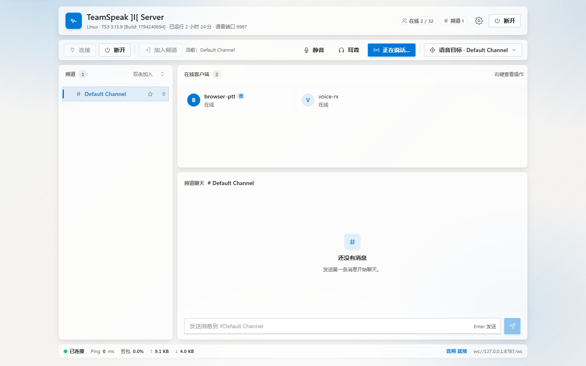

# ts3-compat

**服务端兼容的 TeamSpeak 3 客户端** —— Node.js 协议后端 + Fluent 设计规范 Web 前端。
不是界面原型：可以连接**真实的** TeamSpeak 3 服务端，握手、频道树、文字聊天、Poke、**双向 Opus 语音**全部实测跑通。

[](https://github.com/wanwen371/ts3-compat/actions/workflows/ci.yml)

-blue)




> 截图里的服务器名、版本号、运行时长、在线人数、频道与成员列表，都是握手后从真实 **TeamSpeak 3 Server 3.13.9** 拿到的数据；
> 右下角是浏览器按住说话时对端实际收到的 Opus 帧统计。

---

## 亮点

- **从零实现 TS3 线协议**：`INIT1` 握手（三种变体）、RSA puzzle、AES-128-EAX（8 字节截断 tag）、每包 SHA-256 KDF、可靠 UDP 通道（ACK/重发/分片）、9 种包类型。
- **浏览器里跑 Opus**：`getUserMedia` → `AudioWorklet` → **WebCodecs `AudioEncoder('opus')`**，48 kHz / 20 ms / 单声道 32 kbps（音乐模式立体声 64 kbps），无 wasm、无第三方库。
- **零构建、零框架**：前端纯 HTML/CSS/ESM，直接由 Node 静态托管；`npm install` 只装一个依赖 `ws`。
- **Fluent 设计规范**：亚克力卡片 `rgba(255,255,255,.7)` + `blur(20px)`、主蓝 `#0078d4`、按钮 2px / 卡片 8px 圆角、2px 焦点环、150–250 ms 动效、4px 栅格。
- **逆向依据随仓库发布**：`docs/re/` 是客户端/服务端二进制逆向的原始报告，`test/capture/` 是真客户端握手抓包（106 包），协议实现逐条对得上。

---

## 快速开始

### 1. 连接你自己的服务器

```bash
npm install
npm start                    # → http://127.0.0.1:8787
```

浏览器打开 `http://127.0.0.1:8787/`，填地址 / 端口 / 昵称（需要时填服务器密码）→ 连接。

### 2. 只看界面（不需要服务器）

```bash
npm start
# 打开 http://127.0.0.1:8787/?mock=1
```

内置演示数据，可以直接浏览频道树、聊天、设置、右键菜单等全部界面。

### 3. 本地起一个测试服务端

```bash
# 官方 Linux 服务端 3.13.9（自行下载解压）
cd ts3server-test
TS3SERVER_LICENSE=accept ./ts3server inifile=ts3server.ini \
  default_voice_port=9987 query_port=10011 filetransfer_port=30033
```

> `ts3server-test/` 已在 `.gitignore` 中：官方二进制与 `server.log`（含 serveradmin 密码 / 权限密钥）不入库。

---

## 已验证的能力（真实服务端，2026-11-21）

| 能力 | 状态 | 证据 |
|---|---|---|
| INIT1 握手（三变体）+ RSA puzzle + AES-128-EAX 会话 | ✅ | `node test/client-cli.js`：握手 **33–40 ms**，服务端正常分配 clid |
| 服务器信息 / 频道树 / 客户端列表 | ✅ | 同上；UI 渲染真实数据（见上方截图） |
| 文本聊天（服务器/频道/私聊） | ✅ | 发 `sendtextmessage` → 收到 `notifytextmessage` 回显 |
| Poke 戳一戳 | ✅ | `conn.poke()` |
| 加入 / 切换频道、自身状态（静音、离开、昵称） | ✅ | `clientmove` / `clientupdate` |
| **语音双向（Opus 48k/20ms）** | ✅ | 浏览器按住说话 3 秒 → 对端收到 **148 个 Opus 帧**（`test/browser-voice-e2e.mjs`） |
| 语音转发字节一致性 | ✅ | 两条真连接经服务器转发，帧字节逐一相同（`test/voice.test.js`） |
| WS 上行语音桥接 | ✅ | `VOICE BRIDGE OK`：10 帧 → 桥 → 协议层 → 服务器 → 接收端 |
| 页面错误 | ✅ | 全流程 console error **0** 条 |

## 功能范围

**26 / 51** 项已实现，完整矩阵见 **[docs/features.md](docs/features.md)**。

| 分组 | 已实现 | 待做 |
|---|---|---|
| 连接与协议 | 握手、加密、重发、断线重连、心跳统计 | ServerQuery 管理面板 |
| 频道 / 成员 | 频道树、成员列表、本人状态、加入切换 | 频道创建/编辑、权限编辑器 |
| 消息 | 频道/服务器/私聊文字、Poke、Toast 通知 | 文件传输、离线消息 |
| 语音 | 双向 Opus、PTT、设备选择、质量档、前处理开关 | 抖动缓冲可视化、Whisper UI、3D 音效、录音、Speex/CELT |
| 界面 | Fluent 全套页面、右键菜单、设置、响应式、键盘可达 | 多服务器标签、深色主题、书签、声音包 |

---

## 架构

```
浏览器（Fluent UI，web/ —— 零构建）
   │  WebSocket JSON（op/ev 协议，见 docs/api.md）
   ▼
Node 后端（server/app.js）—— 静态托管 + WS 桥 + 快照去抖 + 语音上下行
   │  EventEmitter
   ▼
协议层（server/ts3/ —— 无 UI 依赖，可单独作为库使用）
   ├ crypto.js      AES-128-CMAC/EAX（tag 8B）、SHA-256 每包 KDF、RSA puzzle
   ├ packet.js      9 种包类型、入站 13B / 出站 11B 头、MTU 500/1108、isValid 判据
   ├ handshake.js   INIT1 状态机（34 / 38 / >314 三变体）、身份密钥、initserver 解析
   ├ connection.js  UDP、可靠通道（ACK/重发/分片）、命令与事件、语音收发、统计
   ├ command.js     TS3 命令语法（转义、多行参数、错误码）
   └ voice.js       语音包编解码（c2s 13B 头 / s2c 11B 头、多帧、Whisper 目标列表）
   │  UDP 9987
   ▼
TeamSpeak 3 Server（语音透明转发，不做编解码）
```

代码量约 **13.7k 行**：协议层 3.8k、前端 7.9k、测试 2.0k。

---

## 协议逆向：四个关键发现

完整推导见 [docs/ghidra/handshake-findings.md](docs/ghidra/handshake-findings.md)，原始报告见 [docs/re/](docs/re/)。

1. **INIT1 的真实布局与三种变体**
   `TS3INIT1`(8B) `| 00 65 | 00 00 | 0x88 | 0x0e | dc 3a e6 | variant@17`，变体 0 / 2 / 4 分别对应长度 **34 / 38 / >314**（38 字节版本要回显服务端尾部 4 字节）。
   结论由**真客户端抓包**与**服务端 `IncomingPacket::isValid()` 反编译**双向确认，`test/handshake.test.js` 把字节布局钉死。

2. **"出站 11 字节、入站 13 字节"之谜**
   差在 client → server 的多 2 字节 `packetId` + 2 字节 `clientId`；语音包两个方向布局还不同（s2c 把发送者 clid 放进 payload）。搞错方向会被服务端静默丢包。

3. **握手前的 ACK 必须用 fake-EAX**
   早期 ACK 不能用"未加密 + 共享 MAC"，必须用固定假密钥（`c:\windows\syste` / `m\firewall32.cpl`）走 EAX —— 这就是服务端日志里 `15 resends of COMMAND packet` 的真正原因。

4. **`serverinfo` 报 2568 不是 bug**
   匿名 guest 组确实没有 `serverinfo/channellist/clientlist` 权限。真客户端的做法是：用服务端 welcome push + `initserver` 组装首屏快照 —— 本项目照做，因此首屏无需任何特权命令。

---

## 测试

```bash
node test/handshake.test.js        # 27 项离线单测：CMAC/EAX/KDF/INIT1 字节布局/命令语法/QuickLZ
node test/voice.test.js            # 47 项：语音包编解码 + 真实双连接转发（需本地服务端）
node test/client-cli.js --host 127.0.0.1 --port 9987 --nickname probe --channel 1
node test/ws-smoke.mjs             # WebSocket 桥事件
node test/voice-bridge.mjs         # WS 上行语音 → 真服务器 → 接收端
node test/browser-e2e.mjs          # 浏览器 UI 登录全流程（需 Chrome --remote-debugging-port=9333）
node test/browser-voice-e2e.mjs    # 浏览器 PTT 语音全链路
node test/udp-relay.js 9999 9987   # UDP 抓包中继（配合官方客户端复现握手）
```

CI 只跑不需要服务端的部分（`node --check` + 27 项离线单测），详见 [.github/workflows/ci.yml](.github/workflows/ci.yml)。

---

## 目录结构

```
.
├── server/
│   ├── app.js            静态托管 + WS 桥（8787）
│   └── ts3/              协议层（crypto / packet / handshake / connection / command / voice）
├── web/                  Fluent UI：index.html / styles.css / app.js / audio.js
├── test/                 单测、真服务器集成、浏览器 E2E、抓包中继
│   └── capture/          真客户端握手抓包（106 包 ground truth）
├── docs/
│   ├── api.md            WebSocket 协议与模块契约
│   ├── features.md       51 项功能矩阵与状态
│   ├── protocol.md       语音协议分册（逆向 06）
│   ├── server.md         服务端分册（逆向 05）
│   ├── design.md         Fluent 设计规范
│   ├── ghidra/           握手反编译发现与关键函数伪代码
│   └── re/               逆向报告总集（架构 / 语音客户端 / 主题 / RTTI / 伪代码）
└── package.json          唯一依赖：ws
```

## 文档索引

| 文档 | 说明 |
|---|---|
| [docs/api.md](docs/api.md) | 前后端 WebSocket 契约：`op`/`ev` 全表、字段与错误码 |
| [docs/features.md](docs/features.md) | 51 项功能矩阵、每项状态与验证方式 |
| [docs/protocol.md](docs/protocol.md) | 语音与命令协议：包头、加密、ACK、分片、Opus 参数 |
| [docs/server.md](docs/server.md) | 服务端模型：配置、数据库、权限、ServerQuery |
| [docs/design.md](docs/design.md) | Fluent 设计规范（颜色、圆角、动效、字体、栅格） |
| [docs/ghidra/handshake-findings.md](docs/ghidra/handshake-findings.md) | 握手逆向推导全过程 |
| [docs/re/](docs/re/) | 逆向报告总集（含 RTTI 与反编译伪代码） |

---

## 已知限制

- 匿名 guest 组没有 `serverinfo / channellist / clientlist` 权限（服务端返回 **2568**），首屏走 welcome push + `initserver`；需要更高权限时可填服务器密码或改用有权限的身份。
- 浏览器不支持 **WebCodecs** 时只能收发文字（`web/audio.js` 会优雅降级并提示）。
- 只实现 **Opus**；Speex / CELT 需要额外 wasm 解码器。
- 官方 116 个 `ts3plugin_*` 插件 ABI 无法在 Web 端复现，属明确不做项。
- Whisper / 文件传输 / 权限编辑 / 录音等在矩阵中标注为待做（见 [docs/features.md](docs/features.md)）。

## 免责声明

本项目为**协议互操作性研究与学习**用途，与 TeamSpeak Systems GmbH 无任何隶属或背书关系。
仓库不包含、也不再分发任何官方二进制、图标或资源文件；`TeamSpeak` 是其各自权利人的商标。
请仅在**你有权连接的服务器**上使用，并遵守当地法律与服务器规则。

## 许可

[MIT](LICENSE)。欢迎 issue / PR；协议细节有疑问可先看 `docs/re/` 与 `docs/protocol.md`。

## 致谢

- 密码学向量取自 RFC 4493（AES-CMAC）与 tsproto 参考实现（`initivexpand2` 密钥调度），用于交叉校验。
- 逆向工具链：Ghidra 12.2 + JDK 25、REA 6.10.1、IDA（辅助）。